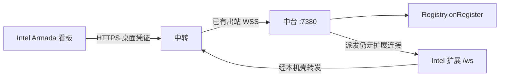
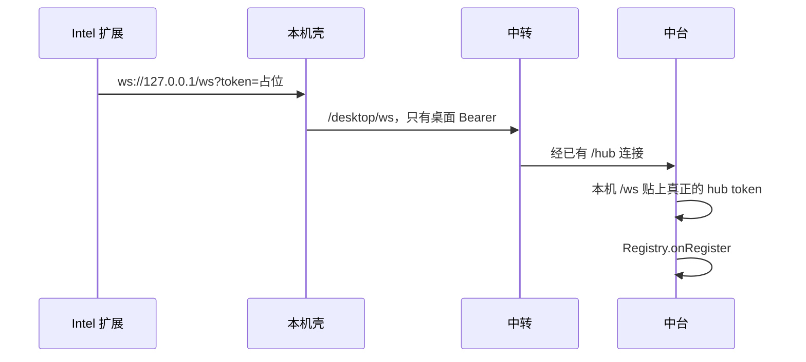
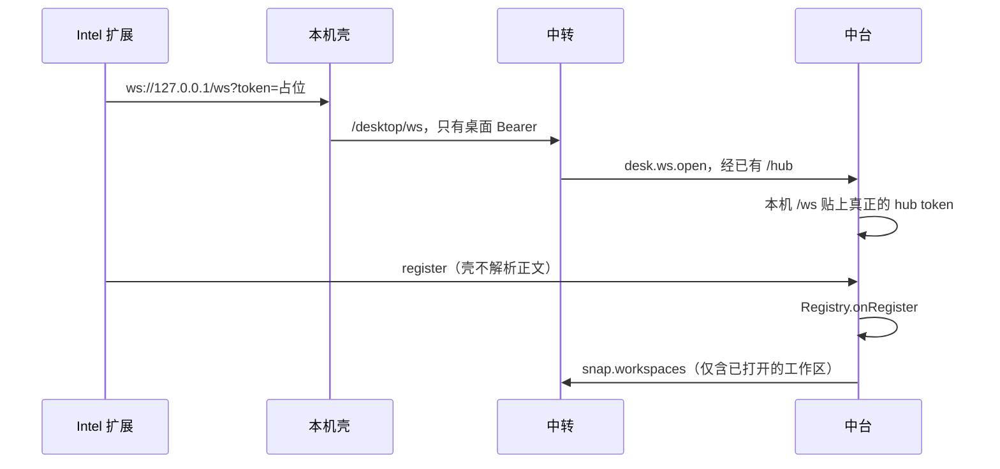

# 跨网络受控机：经中转加入

- 日期：2026-10-12
- 状态：**评审通过**。可作为实施基准。按第 7 节先写会失败的测试，再改生产代码。210 仍等阶段 4。
- 父文档：[2026-09-12-armada-relay-mobile-design.md](./2026-09-12-armada-relay-mobile-design.md)（中转；手机走 `/mobile/*`；不把 `:7380` 映射到公网）
- 核对台账：[2026-10-11-armada-cross-lan-fleet-probe.md](./2026-10-11-armada-cross-lan-fleet-probe.md)
- 凭证：不要把 `~/.armada/token`、`relay.json` 的 `secret`、操作者 token、桌面 token 写进仓库、评审评论或截图。

---

## 0. TL;DR

| 项 | 内容 |
| --- | --- |
| 问题 | 另一网段的电脑要成为和局域网受控机一样的成员，并且它的 Armada 打开这支中台的完整看板。私网 `:7380` 不通。现有中转读接口不能登记机器 |
| 核心方案 | 中台继续出站连接中转。桌面用新的 `armada-relay://desktop` 凭证把看板 HTTP 和扩展 `/ws` 经这条出站连接转回中台。机器仍只由 `Registry.onRegister` 写入 |
| 关键约束 | ① 不把 `:7380` 映射到公网。② hub token 只在中台访问 `127.0.0.1` 时贴上，不抄到 Intel，不进入中转。③ 局域网 `armada://join` 与手机 `/mobile/*` 行为不变。④ 同一 `fleet` 仍只有一条中台连接。⑤ 短 JSON 与看板 SSE、扩展 WebSocket 分开计时 |
| 明确不做 | 第二份中台；手机改看完整看板；在 Intel 上对着现有安装包继续试加入；未写先红测试就改 `relay/src/server.ts` |



---

## 1. 背景与需求

2026-10-12 用另一台 `MacBook-Pro`（IPv4 前三段 `192.168.2`）核对过。中台当时的 `en0` 是 `192.168.1.196/23`。两边都把去对方的主机路由改到局域网网卡之后，对 `192.168.1.196:7380` 的 TCP 在 2 秒内超时。中转 `GET /health` 与带操作者凭证的 `GET /mobile/workspaces` 返回 200，`hubOffline` 为 false。210 上的 `fleets.workspaces` 仍是已有的 `Win Destop` 与 `Mac Arm New`，没有这台 Intel。本机侧栏也没有新的在线受控机。

| # | 诉求 | 设计映射 |
| --- | --- | --- |
| R1 | Intel 作为受控机加入，和普通受控机一样 | 扩展仍发送现有 `register` / 心跳；写入点仍是 `hub/src/registry.ts` 的 `onRegister` |
| R2 | Intel 的 Armada 有中台完整看板 | 看板仍是中台 `hub/web` 的页面与 `/api/*`，经中转转发，不在中转重做一套 UI |
| R3 | 加入方式不同 | 新邀请 `armada-relay://desktop`。局域网仍用 `armada://join?hub=<ip>:7380` |
| R4 | 跨网络不依赖私网路由 | 中台出站，Intel 只访问中转的 HTTPS。不要求两边 `en0` 互通 |
| R5 | 先评审再落地 | 第 10 节已通过。生产代码从第 7 节阶段 1 开始，先红测试 |

---

## 2. 现状盘点

| 类别 | 内容 |
| --- | --- |
| 可复用 | 中台出站：`hub/src/relayClient.ts` 连接 `wss://{relay}/hub`。`hubFetch` 已经请求 `http://127.0.0.1:${hubPort}`。登记只在 `Registry.onRegister`（`hub/src/registry.ts`）执行 `INSERT INTO machines`；10 秒不登记关闭码 4001 也在这里。扩展心跳 15 秒、45 秒无入站重连、退避上限 30 秒：`extension/src/wsClient.ts`。看板实时流是 SSE：`/api/events?token=`（`hub/web/src/App.tsx`）和 `/api/runs/:id/stream?token=`（`hub/web/src/api.ts`）。`auth.ts` 的 `allowsQueryToken` 只允许这几条 GET 把 token 放在查询串。手机：`/mobile/*` + Bearer。`GET /health` 正文含 `protocolVersion`（`relay/src/server.ts`） |
| 需新建 | 桌面凭证与 `armada-relay://desktop`。`/hub` 上的桌面帧（第 4.4 节）。中转把改写后的路径转回中台。壳在 `127.0.0.1` 上剥掉查询串里的占位 token，再只带桌面 Bearer 出门 |
| 不能沿用 | `ensureColumn` 加 `TEXT NOT NULL UNIQUE`：它只做 `ADD COLUMN`（`relay/src/db.ts`）。SQLite 不接受这样的 `UNIQUE`；已有行时没有默认值的 `NOT NULL` 会失败。`DISPATCH_TIMEOUT_MS`（15 秒）只包住 `waitHub` 的 `cmd.*`，不是通用 HTTP 超时。`fleets.workspaces` 只保存有打开工作区的槽位（`relay/src/server.ts` 解析 `snap.workspaces` 时跳过空列表） |
| 已证明不可用 | `join_fleet`（`desktop/src-tauri/src/hub.rs`）直连私网。`GET /mobile/workspaces` 不调用 `onRegister`。把 `:7380` 映射到公网。把 `~/.armada/token` 抄到 Intel |

今天 `/hub` 只交换 JSON：中台到中转是 `snap.workspaces`、`snap.run`；中转到中台是 `cmd.*`；中台回到中转是 `cmd.result`。中转解析失败就丢掉。中台侧不是 `cmd.` 开头就返回（`createRelayCommandHandler`）。二进制帧和 SSE 块没有载体。`/ws` 升级写在 `Bun.serve` 的 `fetch` 里（中台 `hub/src/index.ts`，中转的 `/hub` 同样）。只注册 Hono 路由完不成升级。

---

## 3. 设计原则

1. **一份中台。** 机器、run、看板数据仍在中台 SQLite。中转只转发，不写 `machines`。
2. **登记只有一个入口。** `Registry.onRegister`（`hub/src/registry.ts`）。中转出现新的机器行视为失败。
3. **局域网加入不改语义。** `armada://join`、`ws://{hub}:7380/ws?token=`、`boardUrl` 的 `http://` 查询参数只留给同一局域网。
4. **公网请求必须先过桌面凭证。** 未通过的请求不到达中台进程。
5. **凭证分开放。** 沿用父文档「pair / op 不互换」。桌面 token 是第三条，不复用 `hub_secret` 或操作者 token。
6. **扩展协议不重写。** `register` 字段保持 `machineId`、`windowId`、`name`、`os`、`openWorkspaces`。变的是承载连接，不是消息。
7. **先红测试再改生产。** 见第 8 节。Intel 只做 210 部署后的验收，不对着当前安装包再试加入。

### 3.1 已否决方案

| 方案 | 为什么不选 |
| --- | --- |
| 继续用 `armada://join` 直连私网 | 2026-10-12 在双方路由都走局域网网卡时 TCP 超时。跨网络没有这条路由 |
| 只让 Intel 调 `GET /mobile/workspaces` | 210 已证明这只读旧快照，侧栏不出现新机器，Intel 也没有完整看板 |
| Intel 再 `pair` 成第二台中台 | `relay/src/server.ts` 同一 `fleet` 只保留一条 `role: "hub"` 连接，会顶掉现有中台 |
| 公网反向代理整个 `:7380` | 父文档禁止。未带舰队凭证的客户端也能碰到中台 |
| 复用操作者 token 打开完整看板 | 手机会获得桌面壳才该有的中台页面与 `/ws`。和「令牌不互换」冲突 |
| 把 hub token 经隧道交给 Intel 壳 | 轮换桌面 token 切不断已经写进 Cursor 设置的钥匙。`cc617c1` 评审否决 |
| 用 `DISPATCH_TIMEOUT_MS` 包住整段看板连接 | `EventSource` 安静超过 15 秒会被 502。15 秒只属于 `waitHub` 的短命令 |

### 3.2 范围

| 阶段 | 做 | 不做 | 触发 |
| --- | --- | --- | --- |
| 评审 | 本文 | 生产代码、210 部署 | 已通过 |
| v1 | 桌面凭证、转发、扩展经本机壳登记、Intel 打开完整看板 | 手机完整看板；多中台；改派发状态机 | 评审门禁通过 |
| v1.5 | 看板静态资源在中转侧缓存 | 改变 `/api/*` 语义 | v1 真机看板上首屏超过 3 秒且剖面显示主要耗在静态文件 |
| 不做 | — | 公网 `:7380`；用操作者 token 当桌面凭证 | — |

---

## 4. 数据模型 / 接口契约

### 4.1 桌面邀请

```text
armada-relay://desktop?relay=https%3A%2F%2F<host>&fleet=<fleetId>&token=<desktopToken>
```

| 字段 | 约束 |
| --- | --- |
| `relay` | `https://` origin。环回 `http://127.0.0.1` 仅测试。规则同 `relay/src/uri.ts` 的 `originOf` |
| `fleet` | 现有 `[a-z0-9-]{8,64}` |
| `token` | 64 位小写 hex。不是 `hub_secret`，不是操作者 token |

解析放在 `relay/src/uri.ts`，与 `pair` / `op` 并列。贴错种类时桌面壳拒绝，不拨号。

壳把邀请里的 `fleet` 放进请求头 `x-armada-fleet`。中转用桌面 token 查出的舰队必须与这个头相同。不一致时返回 403 `{ error: "FLEET_MISMATCH" }`，壳不写 Cursor 设置。

**备选不选把桌面 token 放进 `armada://join`：** 和局域网 hub token 混在同一个 scheme。

### 4.2 `desktop_token` 迁移

不使用 `ensureColumn(db, "fleets", "desktop_token", "TEXT NOT NULL UNIQUE")`。`ensureColumn` 只会执行 `ALTER TABLE ... ADD COLUMN`。SQLite 不能在这条语句里加 `UNIQUE`。表里已有舰队时，没有默认值的 `NOT NULL` 会失败。空字符串再补唯一约束，会在第二行冲突。

v1 迁移，单独函数，包在失败可继续启动的路径里：

1. 若无此列：`ADD COLUMN desktop_token TEXT`（可空，无唯一约束）。
2. 每一行 `desktop_token` 为空时，写入各自的 64 位小写 hex。不写空字符串。
3. 全部现有行都有值之后，再 `CREATE UNIQUE INDEX IF NOT EXISTS fleets_desktop_token_uq`。索引已经存在不算迁移失败。

任一步失败：记下错误，不让进程退出。`/mobile/*` 与现有 `/hub` 仍按今天的方式服务。新舰队在 `createFleet` 里直接写入非空 `desktop_token`。管理接口在列可用时多返回 `desktopUri`。日志不打印 token 全文。

**备选不选重建整张 `fleets`：** 210 上已有手机通道和未完成的 run。换表失败面比加可空列大。

### 4.3 路径与时限

公网只有 `Authorization: Bearer <desktopToken>`。壳在回环上认到占位 token 之后把它删掉，再换上桌面 Bearer。`desk.http` 的 `path` 保留其余查询串，至少留住 `archived`、`limit`、`fromEnd`、`path`。只删 `token`。中转日志不记录这个键。

| 入口 | 到中台的路径 | 时限 |
| --- | --- | --- |
| `GET /desktop/health` | 不转发。留在中转 | 无中台超时 |
| `/desktop/`、`/desktop/assets/...` | 去掉 `/desktop` 前缀。`/desktop/` 到中台是 `/`，`/desktop/assets/...` 到中台是 `/assets/...`。页面和静态文件由 `hub/src/index.ts` 的 `serveStatic` 提供，不在 `/api` 下 | 与短 JSON 相同：**15 秒**，超时 502 `{ error: "HUB_TIMEOUT" }` |
| `/desktop/api/...` | `/api/...` | 普通 JSON：**15 秒**，超时 502 `{ error: "HUB_TIMEOUT" }` |
| `/desktop/api/events`、`/desktop/api/runs/:id/stream` | `/api/events`、`/api/runs/:id/stream` | 流式转发。空闲不断。中台的 `:ok` 和后续事件原样下送 |
| `/desktop/ws` | `/ws` | 不按 15 秒切断。扩展侧仍是 45 秒无入站再重连，退避上限 30 秒 |

`/desktop/health` 的正文与现有 `GET /health` 相同：`{ ok: true, name: "armada-relay", protocolVersion: 1 }`（`PROTOCOL_VERSION`）。不要写成只有 `ok` 和 `name`。

`/desktop/ws` 的升级放在 `Bun.serve` 的 `fetch` 里，与现有 `/hub` 相同。不放在只走 Hono 的路由上。

无凭证 401 `{ error: "unauthorized" }`。操作者 token 或 `hub_secret` 为 403 `{ error: "DESKTOP_REQUIRED" }`。`hub_online != 1` 为 503 `{ error: "HUB_OFFLINE" }`。这三档都不把请求送到中台。

中转到中台仍走已经建立的 `/hub` 出站连接，不从公网连回 `:7380`。

### 4.4 `/hub` 帧

短 JSON、SSE 和扩展 WebSocket 都用新的 `desk.*` 帧。`streamId` 与 `cmd.*` 的 `requestId` 分开。桌面流不进入 `waitHub`。手机 `cmd.dispatch` 仍只受自己的 15 秒限制。

| 方向 | `type` | 字段 | 上限 |
| --- | --- | --- | --- |
| 中转 → 中台 | `desk.http` | `streamId`、`seq`、`last`、`method`、`path`、`headers`、可选 `bodyBase64` | 单帧正文 64 KiB |
| 中台 → 中转 | `desk.http.result` | `streamId`、`seq`、`last`、`status`、`headers`、可选 `bodyBase64` | 单帧正文 64 KiB |
| 中转 → 中台 | `desk.stream.open` | `streamId`、`path`（已改写成 `/api/events` 或 `/api/runs/:id/stream`） | — |
| 中台 → 中转 | `desk.stream.chunk` | `streamId`、`seq`、`data`（SSE 文本，含 `:ok`） | 单帧 64 KiB |
| 双向 | `desk.stream.end` | `streamId`、可选 `status` | — |
| 中转 → 中台 | `desk.ws.open` | `streamId` | 每 fleet 同时最多 8 条 |
| 双向 | `desk.ws.frame` | `streamId`、`seq`、`last`、`data`（扩展现有文本帧） | 单帧 64 KiB。一条文本帧超过 64 KiB 时拆开，收齐后整段写入本机 `/ws`。不因为这一条大文本帧关闭桌面套接字。v1 不转发二进制帧；二进制仍以 1003 关闭这一条，不断开 `/hub` |
| 双向 | `desk.ws.close` | `streamId`、`code`、`reason` | 至少原样送回 4001（未登记）和 4000（被替换） |

`desk.http`、`desk.http.result`、`desk.ws.frame` 使用同一条拼包规则：`seq` 从 0 递增，最后一帧 `last: true`。收齐连续的 `0..n` 且见到 `last: true` 之后，才把完整正文交给本机 HTTP，或拼回给壳。缺序号不把半截正文交给下游。

15 秒按帧间空闲计算，不按整段正文计算。只有一帧的短 JSON：从发出到 `last: true` 超过 15 秒则 502。附件、JS 包、大 JSON 会有多帧：上一帧之后 15 秒内必须见到下一帧或 `last: true`，否则这条 `streamId` 502。整段上传或下载可以超过 15 秒。看板会超过 64 KiB 的响应包括 `/api/runs/:id/events`、`/api/blobs/:id`（上限 `MAX_BLOB_BYTES` = 8MB，`hub/src/blobs.ts`）和页面的 JS 包。

`desk.stream.chunk` 没有 `last`。按 `seq` 顺序立刻写入 SSE 响应，不等待流结束，也不套上面的 15 秒。SSE 的结束只看 `desk.stream.end` 或连接断开。

未知 `type`：中转和中台都忽略该帧，不关闭 `/hub`。中转先发布、中台仍是旧进程时，旧的 `createRelayCommandHandler` 会忽略非 `cmd.` 帧，`/mobile/*` 保持今天的行为。桌面短请求在 15 秒后 502，不占用 `waitHub`。

验收用例：一条桌面 SSE 保持打开且 15 秒内没有业务包时，手机 `cmd.dispatch` 仍在 15 秒内返回。

### 4.5 hub token 留在中台

没有「把 hub token 返回给壳」的接口。`POST /join/ticket` 也不能用：它要求已持有中台凭证的人先签发 ticket。

v1：

- Intel 的 `armada.token` 是壳生成的 64 位小写 hex 占位值。扩展仍然发 `ws://${hubUrl}/ws?token=`。协议字段不改。
- 壳监听的转发只绑 `127.0.0.1`。占位 token 出现在两个位置，对上之后删掉，再换上桌面 Bearer。只查查询串时，`GET /api/machines` 对不上，壳会把它丢掉。

| 来源 | 占位 token 在哪 | 代码 |
| --- | --- | --- |
| 页面、`EventSource`、扩展 `/ws` | 查询串 `token` | `boardUrl`、`App.tsx` 的 `/api/events?token=`、`api.ts` 的 `streamUrl`、扩展的 `ws://${hubUrl}/ws?token=` |
| 看板的 `/api/*` | `Authorization: Bearer <占位>` | `hub/web/src/api.ts` 的 `req()`、`uploadBlob`、`getBlob`，以及 `RunDetail.tsx` 的 `/api/audit/export`。这些请求的路径上没有 `token`。认的是这个头，不是函数名单 |

- 中台沿用 `hubFetch`。真正的 hub token 只加在 `http://127.0.0.1:${hubPort}` 上。v1 把 `authorization: Bearer ${opts.token}` 放在展开调用方头之后，调用方头不能覆盖它。默认 `content-type: application/json` 留在展开调用方头之前。现有 `cmd.*` 没有这个头，靠的就是这个默认值。`cmd.blobPut` 再用自己的 multipart 盖掉它。不要改成让 `cmd.*` 自己带 `content-type`。
- 中台本机 `/ws` 升级仍对照 `~/.armada/token`（`hub/src/index.ts`）。这个查询参数由中台在回环上补上，不由中转或 Intel 提供。



**备选不选把占位值留空：** `loadConfig` 在 token 为空时不连接（`extension/src/config.ts`）。占位值让现有扩展不用改字段。

### 4.6 桌面壳

局域网加入不变：`webviewOrigin` 为 `ip:7380`，`openBoard` 使用 `boardUrl`。

中转加入成功后：

| 项 | 值 |
| --- | --- |
| 看板 iframe | `boardUrl("127.0.0.1:<壳端口>", 占位)`，即 `http://127.0.0.1:<端口>/?token=<占位>&desktop=1`（`desktop-core/src/shellUi.ts`）。没有查询串时，看板走到浏览器粘贴页，向用户要 `~/.armada/token`（`hub/web/src/App.tsx`）。`need-token` 只在 `isDesktopShell` 为真时发出，也就是查询串里有 `desktop=1`（`hub/web/src/tokenBootstrap.ts`） |
| 出门的文档请求 | 占位值从查询串或 `Authorization` 删掉后再出门。`desktop=1` 不转发。其余查询串保留。`/` 与 `/assets/...` 转到 `/desktop/` 与 `/desktop/assets/...`，`/api/...` 转到 `/desktop/api/...` |
| 回环核对 | 查询串 `token` 或 `Authorization: Bearer` 有一个等于占位值即可。对上之后删掉占位值，换上桌面 Bearer，再转发。两个位置都不是占位值时，不加桌面 Bearer，也不转发 |
| `armada.hubUrl` | `127.0.0.1:<壳端口>`。端口固定 |
| `armada.token` | 第 4.5 节的占位值 |
| 再次打开 | `~/.armada/desktop-join.json`（mode `0600`）含 `relay`、`fleet`、桌面 token 和这个固定端口。不含 hub token。扩展只在 `activate` 里调用 `loadConfig()`（`extension/src/extension.ts`），已经打开的 Cursor 不会改连新端口。再次打开时先绑定文件里的端口，再等扩展重连。该端口绑不上时，壳显示失败，不改用别的端口，也不改写已有 `hubUrl`。不必重贴邀请 |
| 离开舰队 | 壳停掉回环监听，删除该文件，并清掉指向这个 `127.0.0.1` 端口的 `armada.hubUrl` 与占位 `armada.token`。不清局域网加入留下的其他地址 |

邀请里的 `fleet` 与 token 查出的舰队不一致时，不写上述文件，也不写 Cursor 设置。

### 4.7 兼容

| 客户端 | v1 行为 |
| --- | --- |
| 已在局域网的受控机 | 不改 `hubUrl`，不经过 `/desktop/*` |
| 手机 | 仍只接受操作者 token 调 `/mobile/*`。桌面 token 调 `/mobile/*` 返回 403 `OPERATOR_REQUIRED`。限流仍是现有 `checkRate`：20 次 / 5 分钟，桌面流量不进这个桶 |
| 中转已升级、中台未升级 | 未知 `desk.*` 被旧中台忽略。操作者 `GET /mobile/workspaces` 仍 200 |
| 旧中转进程 | 没有 `/desktop/*` 时壳显示连接失败，不改写已有局域网 `hubUrl` |

---

## 5. 运行时链路

### 5.1 加入



1. 中台必须已经 `hub_online = 1`。否则 `/desktop/api/*` 与 `/desktop/ws` 返回 503。壳停留在加入页，不写 Cursor 设置，不写 `desktop-join.json`。
2. 扩展发出与今天相同的 `register`。10 秒内未登记，中台仍按 `Registry.onOpen` 以 4001 关闭。`desk.ws.close` 把 4001 送回扩展。中转不解析 `register`。
3. 心跳仍是扩展每 15 秒一次。中转不另设心跳来代替它。
4. 看板文档走壳的回环。`/api/events` 与 `/api/runs/:id/stream` 走 `desk.stream.*`，空闲不断。短 JSON 才使用 15 秒。中转不改 `runs` 表。`cmd.dispatch` 仍走 `waitHub`。

### 5.2 失效与降级

| 情况 | 行为 |
| --- | --- |
| 中转不可达 | 壳显示失败。不回退去拨私网 `7380` |
| 中台出站断开 | 现有逻辑把 `hub_online` 置 0。新的桌面入口得到 503。已登记机器由中台离线逻辑处理。中转不代标 online |
| 桌面 Bearer 错误，或 `FLEET_MISMATCH` | 401 或 403。壳不写 `hubUrl` |
| 短 JSON 超过 15 秒 | 502 `HUB_TIMEOUT`。SSE 与 `/desktop/ws` 不因此关闭 |
| 扩展 45 秒无入站 | 扩展自己重连，退避上限 30 秒 |

回滚：中转停止接受 `/desktop/*`，重新部署。局域网加入与 `/mobile/*` 不依赖这些路由。离开舰队时壳停掉 `127.0.0.1` 监听，并清掉指向该回环的 `armada.hubUrl`。不迁移 `machines` 表。

缓存：短 JSON 不在中转缓存。SSE 不缓冲成完整响应再下发。静态文件 v1 不缓存。

---

## 6. 安全与威胁模型

| 威胁 | 缓解 | 剩余风险 |
| --- | --- | --- |
| 公网扫到中台 `:7380` | 不映射该端口。中台只出站 | 中台所在网络自己把 7380 暴露出去时，本文没有新增防护 |
| 偷到操作者 token 后打开完整看板 | `/desktop/*` 拒绝操作者 token，403 `DESKTOP_REQUIRED` | 偷到的是桌面 token。轮换 `desktop_token` 后这条凭证失效。hub token 仍在中台，不随桌面 token 一起离开 |
| hub token 离开中台 | 公网只有桌面 Bearer。壳在回环上删掉查询串 `token`。`hubFetch` 在展开调用方头之后再写 `Bearer ${opts.token}`，且只发给 `127.0.0.1` | 壳若漏删查询串，占位值会到达中转。占位值不是 hub token。单测必须断言出门请求没有查询串 `token` |
| 桌面 token 与 hub token 混用 | 中转只认 `desktop_token`。对不上则为 401 | — |
| 转发把中转变成第二份权威 | 中转不写 `machines`，不解析 `register`。加入成功只看中台 `hub.db` | `fleets.workspaces` 不含未打开工作区的在线机器。不能用它单独判定加入 |
| `desktop_token` 迁移失败 | 失败时中转继续提供 `/mobile/*`。不因新列拒绝启动 | 桌面入口在列不可用时返回 503，并在日志写迁移失败，不写 token |

审计：沿用 `audit` 表。`actor=desktop`，`action=join.open` 或 `join.denied`，`target` 为 `fleetId`，payload 只有 HTTP 状态码。不记 `machineId`。机器身份以中台 `machines` 为准。

限流使用新桶，不调用 `checkRate`。同一桌面 token 的短 HTTP **每 10 秒最多 120 次**，超出 429 `{ error: "RATE_LIMIT" }`。一次 SSE 或一次 `/desktop/ws` 升级只计 1 次，不按后续帧计数。操作者桶保持 20 次 / 5 分钟。每个 fleet 同时最多 8 条桌面 WebSocket，超出升级失败 429。

---

## 7. 实施路线图

开发在本仓库进行。Intel 不在功能落地前用当前安装包再试加入。

| 阶段 | 内容 | 验收 | 上线门禁 |
| --- | --- | --- | --- |
| 0 | 本文再次评审 | 第 10 节门禁全过 | 已通过。阶段 1 可以开始 |
| 1 | 中转测试先红：迁移能在已有行上补齐各不相同的 `desktop_token`；无凭证与操作者 token 不能打开 `/desktop/ws`；桌面 SSE 打开时 `cmd.dispatch` 仍在 15 秒内返回 | `bun test relay/test` 新用例先红后绿 | 不部署 |
| 2 | 中台在回环上为隧道补 hub token，仍走 `onRegister`。调用方头不能覆盖 `hubFetch` 的 Authorization | `bun test hub/test` 覆盖隧道登记；局域网 `/ws?token=` 用例仍绿 | 不部署 |
| 3 | 桌面壳识别 `armada-relay://desktop`，只听 `127.0.0.1`，出门前去掉查询串 `token` | `desktop-core` 单测：中转加入不生成含 hub token 的公网 URL | 不给 Intel 装 |
| 4 | 部署顺序：先中转（210），再中台（本机，已有出站会重连），再 Intel 的桌面壳与扩展 | 见 7.1 | 前一步健康检查通过才做下一步 |

部署顺序反过来的后果：Intel 先装新壳会向尚未存在的 `/desktop/*` 请求，加入失败；中台先于中转升级没有 `/desktop/*` 可接，行为与今天相同，允许，但没有跨网络能力。

### 7.1 Intel 验收（阶段 4 之后的唯一一次）

| # | 通过标准 |
| --- | --- |
| 加入 | 中台 `hub.db` 的 `machines` 有该行，且 `status=online`。这是加入成功的判定 |
| 看板 | Intel 的 Armada 打开这支中台的完整看板，实时流在安静超过 15 秒后仍不断开 |
| 侧栏 | 本机侧栏与 Intel 看板侧栏都出现在线的 `MacBook-Pro` |
| 快照 | 只有 Intel 打开了工作区，210 的 `fleets.workspaces` 才必须含该 `machineId`。没有打开文件夹时，快照可以没有这一行 |
| 重启 | 退出并重新打开 Intel 上的 Armada 后，不用再贴邀请，该行能回到 `online` |
| 离开 | 离开舰队后，壳停掉回环转发，并清掉指向该回环的 `armada.hubUrl` |
| 手机 | 中转已升级、中台尚未升级时，操作者 token 调 `GET /mobile/workspaces` 仍是 200。桌面 token 调同一路径为 403 |

未达到「加入」这一条时，不发「已加入」结论。按 210 与中台日志改转发，不让 Intel 改路由或直连 `7380`。

---

## 8. 测试

| 路径 | 期望 |
| --- | --- |
| 已有两行 `fleets` 的库做迁移 | 两行得到不同的 64 hex；唯一索引建成；迁移抛错时 `/mobile/workspaces` 仍 200 |
| 桌面 token 的 `desk.ws.frame` 送到中台后完成 `register` | `machines` 有该行且 `status=online`。中转审计 payload 无 `machineId` |
| 无 `Authorization` | 401，中台机器行数不变 |
| 操作者 token 或 `hub_secret` 调 `/desktop/ws` | 403 `DESKTOP_REQUIRED` |
| 邀请 `fleet` 与 token 所属舰队不同 | 403 `FLEET_MISMATCH`，测试里的壳不写 `hubUrl` |
| 桌面 token 调 `/mobile/workspaces` | 403 `OPERATOR_REQUIRED` |
| `GET /desktop/health` | 200，正文含 `protocolVersion`，且没有对应的 `desk.http` |
| 出门前的回环请求带 `?token=` 和 `desktop=1` | 到达中转的 URL 没有 `token`，也没有 `desktop=1`，也没有 hub Bearer。iframe 本机地址仍是 `boardUrl` 的结果 |
| 只有占位 Bearer、没有查询串 `token` 的 `GET /api/machines` | 壳换上桌面 Bearer 并转发。别的 Bearer 不转发 |
| `desk.http` 的 `path` 原为 `/api/runs?archived=1` 或带 `limit`、`fromEnd`、`path` | 这些查询串保留。只有 `token` 被删掉 |
| 唯一索引已存在 | `CREATE UNIQUE INDEX IF NOT EXISTS` 不算迁移失败。`/mobile/*` 继续服务 |
| `/` 与 `/assets/...` | 经 `/desktop/` 与 `/desktop/assets/...` 转到中台，15 秒时限。`/desktop/health` 仍不转发 |
| 超过 64 KiB 的 JSON、JS 包或 8MB 附件 | `seq` 从 0 连续，最后一帧 `last: true` 之后才拼成完整正文。半截不交给下游。一条大文本帧不关闭桌面套接字 |
| `/api/blobs` 经 `hubFetch` | `content-type` 仍是原请求的 multipart。`authorization` 在调用方头之后，且是中台 hub token |
| 8MB 附件上传进行中，且总时长超过 15 秒 | 上传不被整段 15 秒掐断。帧间空闲超过 15 秒才 502。其间手机 `cmd.dispatch` 仍在 15 秒内返回 |
| `desk.stream.chunk` | 按 `seq` 立刻下送。不因为没有 `last: true` 而攒完整段 SSE |
| SSE 打开且 20 秒无业务包 | 连接仍在。其间 `cmd.dispatch` 在 15 秒内返回 |
| 短 JSON 超过 15 秒 | 502 `HUB_TIMEOUT`。这条 SSE 不被这次超时关掉 |
| 未知 `type` | `/hub` 保持。`/mobile/*` 行为与今天相同 |
| `desk.ws.close` 的 `code` 为 4001 或 4000 | 扩展侧套接字收到同一关闭码 |
| 局域网 `boardUrl("192.168.1.196:7380", token)` | 仍是 `http://192.168.1.196:7380/?token=…&desktop=1` |
| 空工作区的在线机器 | `machines.status=online`。`fleets.workspaces` 不必含该 `machineId` |

真机只在阶段 4。不把 Intel 的探索性操作当作单测替代。

---

## 9. 风险与未决

| 风险 | 影响 | 应对 | 状态 |
| --- | --- | --- | --- |
| 壳漏删查询串 `token` | 占位值到达中转。它不是 hub token，但会污染日志 | 第 8 节单测断言出门 URL 无 `token` | v1 必须有这条测试 |
| 完整看板的静态文件全部经中转 | 首屏变慢 | v1 不缓存。超过 3 秒再开 v1.5 | 未发生 |
| 扩展与壳版本不一致 | 壳已转发但扩展仍指向旧私网 | 阶段 4 同时装壳和扩展。重启验收检查 `hubUrl` 是 `127.0.0.1` | 实施时检查 |
| 迁移失败被写成进程退出 | 210 上手机通道起不来 | 第 4.2 节：失败仍服务 `/mobile/*` | v1 必须如此 |

`cc617c1` 里「隧道可看见 hub token」和「15 秒包住全部转发」两条已经撤掉。

本文假定 Intel 安装的是带本次桌面壳的 Armada，且中台出站已经连着 210 上的中转。出站不在时，验收停在 503，不改判定标准。

---

## 10. 评审检查清单

- [x] 覆盖第 0 节到第 11 节
- [x] v1 / v1.5 / 不做 已分开
- [x] 含非目标、风险、阻塞项（阶段 0）、验收
- [x] 跨组件发布顺序已写明：中转 → 中台 → Intel 壳与扩展
- [x] 修订记录说明相对 `cc617c1` 改了什么
- [x] 同事再次评审通过

骨架四项在 `cc617c1` 已通过。`fec66c5` 的五条契约保留。`64aba73` 的看板四条保留。占位 token 的两个位置保留。本评审补上的只有：多帧正文按帧间空闲计 15 秒，SSE 不等 `last`。本文从此是实施基准。生产代码仍按第 7 节先红测试。

---

## 11. 修订记录

| 日期 | 变更 |
| --- | --- |
| 2026-10-12 | 初稿。依据当天私网 TCP 超时、中转只读成功、210 快照无 Intel 机器，写出经中转的桌面加入方案，供主干评审 |
| 2026-10-12 | 按 `cc617c1` 评审改契约：hub token 留在中台；SSE 与 `/desktop/ws` 不套 15 秒；补 `desk.*` 帧和 `streamId`；`desktop_token` 改为可空列再加唯一索引；加入成功只看 `machines.status=online`。核对台账写回 `192.168.1.196` 与 `192.168.2`。状态仍为待评审 |
| 2026-10-12 | 按 `fec66c5` 评审补看板契约：iframe 使用 `boardUrl`（占位 token 与 `desktop=1` 只留在回环）；`/desktop/` 与 `/desktop/assets/...` 去掉前缀后按 15 秒转发；请求和响应以 `seq` 与 `last: true` 收齐，含超过 64 KiB 的正文和扩展文本帧；壳端口固定写入 `desktop-join.json`，回环先核对占位 token。`fec66c5` 的五条契约保留。状态仍为待评审 |
| 2026-10-12 | 按 `64aba73` 评审补占位 token 的两个位置：查询串 `token`，以及 `api.ts` 的 `Authorization: Bearer`。对上后删掉再换桌面 Bearer。`desk.http` 的 `path` 只删 `token`。`hubFetch` 的默认 `content-type: application/json` 留在展开调用方头之前。唯一索引用 `CREATE UNIQUE INDEX IF NOT EXISTS`，已存在不算失败。`64aba73` 的四条保留。状态仍为待评审 |
| 2026-10-12 | 独立评审通过。多帧正文（附件、JS、大 JSON）改为帧间空闲 15 秒，整段可以超过 15 秒。`desk.stream.chunk` 按序立刻下送，不等 `last`。Bearer 占位同样覆盖 `getBlob` 与 `/api/audit/export`。保存的端口绑不上时不改端口、不改 `hubUrl`。状态改为评审通过 |
