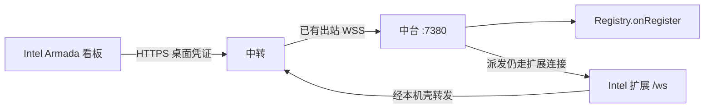
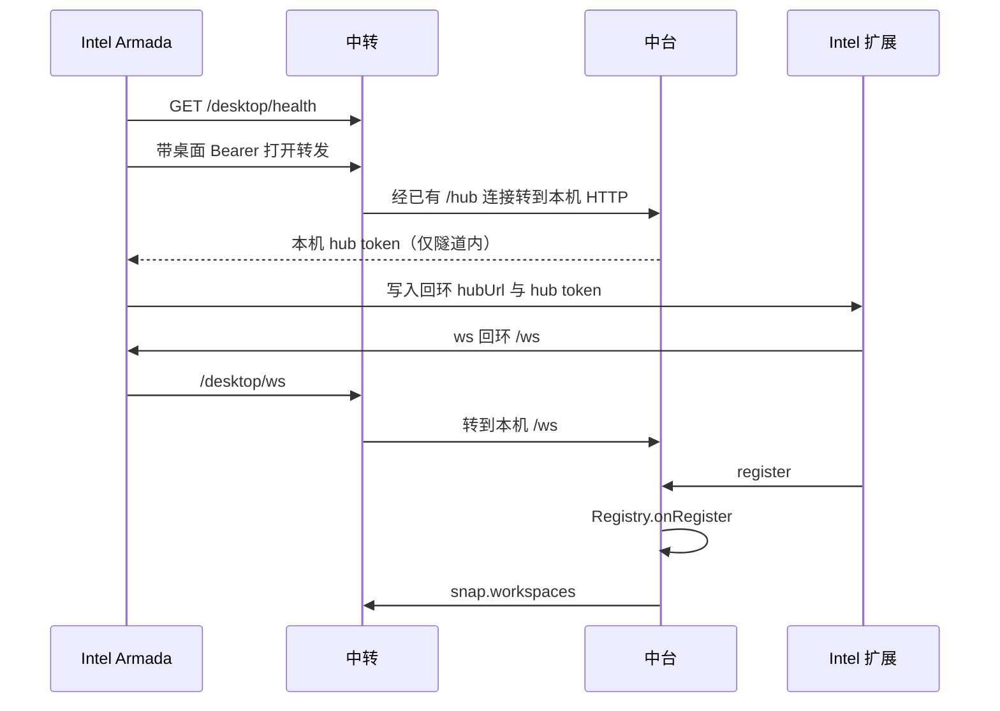

# 跨网络受控机：经中转加入

- 日期：2026-10-12
- 状态：**待评审**。本文不是实施基准。评审门禁未过之前不改生产代码，不部署 210。
- 父文档：[2026-09-12-armada-relay-mobile-design.md](./2026-09-12-armada-relay-mobile-design.md)（中转；手机走 `/mobile/*`；不把 `:7380` 映射到公网）
- 核对台账：[2026-10-11-armada-cross-lan-fleet-probe.md](./2026-10-11-armada-cross-lan-fleet-probe.md)
- 凭证：不要把 `~/.armada/token`、`relay.json` 的 `secret`、操作者 token、桌面 token 写进仓库、评审评论或截图。

---

## 0. TL;DR

| 项 | 内容 |
| --- | --- |
| 问题 | 另一网段的电脑要成为和局域网受控机一样的成员，并且它的 Armada 打开这支中台的完整看板。私网 `:7380` 不通。现有中转读接口不能登记机器 |
| 核心方案 | 中台继续出站连接中转。桌面用新的 `armada-relay://desktop` 凭证把看板 HTTP 和扩展 `/ws` 经这条出站连接转回中台。机器仍只由 `Registry.onRegister` 写入 |
| 关键约束 | ① 不把 `:7380` 映射到公网。② 公网 URL 不带 `token` 查询参数。③ 局域网 `armada://join` 与手机 `/mobile/*` 行为不变。④ 同一 `fleet` 仍只有一条中台连接。⑤ 凭证三者不互通：`hub_secret`、操作者 token、桌面 token |
| 明确不做 | 第二份中台；手机改看完整看板；在 Intel 上对着现有安装包继续试加入；未评审就改 `relay/src/server.ts` |



---

## 1. 背景与需求

2026-10-12 用另一台 `MacBook-Pro`（IPv4 前三段 `192.168.2`）核对过。中台当时的 `en0` 是 `192.168.1.196/23`。两边都把去对方的主机路由改到局域网网卡之后，对 `192.168.1.196:7380` 的 TCP 在 2 秒内超时。中转 `GET /health` 与带操作者凭证的 `GET /mobile/workspaces` 返回 200，`hubOffline` 为 false。210 上的 `fleets.workspaces` 仍是已有的 `Win Destop` 与 `Mac Arm New`，没有这台 Intel。本机侧栏也没有新的在线受控机。

| # | 诉求 | 设计映射 |
| --- | --- | --- |
| R1 | Intel 作为受控机加入，和普通受控机一样 | 扩展仍发送现有 `register` / 心跳；写入点仍是 `hub/src/registry.ts` 的 `onRegister` |
| R2 | Intel 的 Armada 有中台完整看板 | 看板仍是中台 `hub/web` 的页面与 `/api/*`，经中转转发，不在中转重做一套 UI |
| R3 | 加入方式不同 | 新邀请 `armada-relay://desktop`。局域网仍用 `armada://join?hub=<ip>:7380` |
| R4 | 跨网络不依赖私网路由 | 中台出站，Intel 只访问中转的 HTTPS。不要求两边 `en0` 互通 |
| R5 | 先评审再落地 | 本文合并到 `master` 后停。同事通过评审门禁之前不写生产代码 |

---

## 2. 现状盘点

| 类别 | 内容 |
| --- | --- |
| 可复用 | 中台出站：`hub/src/relayClient.ts` 连接 `wss://{relay}/hub`。中转单连接：`relay/src/server.ts` 的 `hubSockets`，`fleets.hub_online`。登记：`extension/src/extension.ts` 发送 `type: "register"`，`Registry.onRegister` 写入 `machines`。看板：`desktop-core/src/shellUi.ts` 的 `boardUrl` 打开 `http://{origin}/?token=…&desktop=1`。手机：`/mobile/*` + `Authorization: Bearer` |
| 需新建 | 桌面凭证与 `armada-relay://desktop`。中转上的桌面入口，把看板 HTTP 和扩展 WebSocket 转回已连接的中台。桌面壳在加入后把 Cursor 的 `armada.hubUrl` 指到本机转发口，而不是私网 `7380` |
| 已证明不可用 | `join_fleet`（`desktop/src-tauri/src/hub.rs`）直连分享链接里的私网地址。`GET /mobile/workspaces` 只读 `fleets.workspaces`，不调用 `onRegister`。把 `:7380` 映射到公网（父文档明确不做） |

中转命令面今天只有 `cmd.*`（`hub/src/relayCommandHandler.ts`），由中转发往中台，给手机派发用。受控机的 `register` 不在其中。

---

## 3. 设计原则

1. **一份中台。** 机器、run、看板数据仍在中台 SQLite。中转只转发，不写 `machines`。
2. **登记只有一个入口。** `Registry.onRegister`（`hub/src/registry.ts`）。中转出现新的机器行视为失败。
3. **局域网加入不改语义。** `armada://join`、`ws://{hub}:7380/ws?token=`、`boardUrl` 的 `http://` 查询参数只留给同一局域网。
4. **公网请求必须先过桌面凭证。** 未通过的请求不到达中台进程。
5. **凭证分开放。** 沿用父文档「pair / op 不互换」。桌面 token 是第三条，不复用 `hub_secret` 或操作者 token。
6. **扩展协议不重写。** `register` 字段保持 `machineId`、`windowId`、`name`、`os`、`openWorkspaces`。变的是承载连接，不是消息。
7. **先红测试再改生产。** 见第 8 节。Intel 只做 210 部署后的验收，不对着当前安装包再试加入。

### 3.1 已否决方案

| 方案 | 为什么不选 |
| --- | --- |
| 继续用 `armada://join` 直连私网 | 2026-10-12 在双方路由都走局域网网卡时 TCP 超时。跨网络没有这条路由 |
| 只让 Intel 调 `GET /mobile/workspaces` | 210 已证明这只读旧快照，侧栏不出现新机器，Intel 也没有完整看板 |
| Intel 再 `pair` 成第二台中台 | `relay/src/server.ts` 同一 `fleet` 只保留一条 `role: "hub"` 连接，会顶掉现有中台 |
| 公网反向代理整个 `:7380` | 父文档禁止。未带舰队凭证的客户端也能碰到中台 |
| 复用操作者 token 打开完整看板 | 手机会获得桌面壳才该有的中台页面与 `/ws`。和「令牌不互换」冲突 |

### 3.2 范围

| 阶段 | 做 | 不做 | 触发 |
| --- | --- | --- | --- |
| 评审 | 本文 | 生产代码、210 部署 | 当前 |
| v1 | 桌面凭证、转发、扩展经本机壳登记、Intel 打开完整看板 | 手机完整看板；多中台；改派发状态机 | 评审门禁通过 |
| v1.5 | 看板静态资源在中转侧缓存 | 改变 `/api/*` 语义 | v1 真机看板上首屏超过 3 秒且剖面显示主要耗在静态文件 |
| 不做 | — | 公网 `:7380`；用操作者 token 当桌面凭证 | — |

---

## 4. 数据模型 / 接口契约

### 4.1 桌面邀请

```text
armada-relay://desktop?relay=https%3A%2F%2F<host>&fleet=<fleetId>&token=<desktopToken>
```

| 字段 | 约束 |
| --- | --- |
| `relay` | `https://` origin。环回 `http://127.0.0.1` 仅测试。规则同 `relay/src/uri.ts` 的 `originOf` |
| `fleet` | 现有 `[a-z0-9-]{8,64}` |
| `token` | 64 位小写 hex。不是 `hub_secret`，不是操作者 token |

解析放在 `relay/src/uri.ts`，与 `pair` / `op` 并列。贴错种类时桌面壳拒绝，不拨号。

**备选不选把桌面 token 放进 `armada://join`：** 和局域网 hub token 混在同一个 scheme。

### 4.2 `fleets` 新列

| 列 | 约束 |
| --- | --- |
| `desktop_token` | `TEXT NOT NULL UNIQUE`，64 hex。已有行在中转进程启动时补空值，不改变 `hub_secret` 与 `operator_token` |

位置：`relay/src/db.ts` 的 `ensureColumn`。创建舰队时与 `operator_token` 一起生成（`relay/src/server.ts` 的 `createFleet`）。管理接口返回的 JSON 增加 `desktopUri`。不在日志打印 token 全文。

### 4.3 中转入口

| 入口 | 认证 | 成功 | 失败 |
| --- | --- | --- | --- |
| `GET /desktop/health` | 无 | 200 `{ ok: true, name: "armada-relay" }`，与现有 `/health` 相同，便于对端先确认主机 | 网络错误由客户端记录 |
| `/desktop/*` HTTP | `Authorization: Bearer <desktopToken>` | 中转把方法、路径、头（去掉该 Bearer）、体转给已连接中台的本机 HTTP，状态码与体原样返回 | 无凭证 401 `{ error: "unauthorized" }`；操作者 token 或 `hub_secret` 403 `{ error: "DESKTOP_REQUIRED" }`；`hub_online != 1` 503 `{ error: "HUB_OFFLINE" }` |
| `/desktop/ws` WebSocket | 同上，Bearer 放在升级请求头，不放查询串 | 帧双向转发到中台 `/ws`。中台侧仍用现有 hub token 完成升级 | 同上。升级失败 401，不建立套接字 |

转发超时与现有 `DISPATCH_TIMEOUT_MS` 对齐：**15 秒**，超时 502 `{ error: "HUB_TIMEOUT" }`。WebSocket 不套这 15 秒在每一帧上；空闲断开对齐扩展现有 `WS_STALE_MS`（45 秒无入站则扩展重连，`extension/src/wsClient.ts`）。

中转到中台的这一跳走已经建立的 `/hub` 出站连接，不新开一条从公网连回 `:7380` 的 TCP。

### 4.4 中台侧

中台在本机回环上接受中转转来的 HTTP 与 `/ws`，鉴权仍是现有 hub token（`hub/src/index.ts`：`/ws` 的 `token` 查询参数必须等于 `~/.armada/token`）。该查询参数只出现在中台本机，不出现在中转的公网 URL 上。

桌面壳在凭证通过后，经这条已认证转发取一次 hub token，写入 Cursor 设置，方式与今天 `join_fleet` 相同。token 不进入 `armada-relay://desktop`。

`register` 到达中台后只调用 `Registry.onRegister`。随后 `snap.workspaces` 仍由现有中台出站推送更新 `fleets.workspaces`。

### 4.5 桌面壳

局域网加入不变：`webviewOrigin` 为 `ip:7380`，`openBoard` 使用 `boardUrl`。

中转加入成功后：

| 项 | 值 |
| --- | --- |
| 看板 iframe | 本机壳的回环地址。壳把请求加上桌面 Bearer 后转到中转 `/desktop/*` |
| `armada.hubUrl` | 该回环 `host:port`。扩展仍执行 `ws://${hubUrl}/ws?token=`（`extension/src/extension.ts`） |
| `armada.token` | 中台 hub token，只存在于受控机本机 |

这样扩展代码的登记消息不变。跨网络的差别停在壳的转发，不把私网 IP 写进 Cursor 设置。

### 4.6 兼容

| 客户端 | v1 行为 |
| --- | --- |
| 已在局域网的受控机 | 不改 `hubUrl`，不经过 `/desktop/*` |
| 手机 | 仍只接受操作者 token 调 `/mobile/*`。桌面 token 调 `/mobile/*` 返回 403 `OPERATOR_REQUIRED` |
| 旧中转进程 | 没有 `/desktop/*` 时桌面壳显示连接失败，不改写本机已有的局域网 `hubUrl` |

---

## 5. 运行时链路

### 5.1 加入



1. 中台必须已经 `hub_online = 1`。否则 `/desktop/*` 返回 503，壳停留在加入页，不写 Cursor 设置。
2. 扩展发出与今天相同的 `register`。10 秒内未登记，中台仍按 `Registry.onOpen` 关闭套接字（4001）。
3. 心跳仍是扩展每 15 秒一次。中转不另设一套心跳来代替它。
4. 看板 iframe 的文档与 `/api/*` 都走 `/desktop/*`。中转不解析 run 状态，不改 `runs` 表。手机那条 `cmd.dispatch` 路径不动。

### 5.2 失效与降级

| 情况 | 行为 |
| --- | --- |
| 中转不可达 | 壳显示失败。不回退去拨私网 `7380` |
| 中台出站断开 | 中转将 `hub_online` 置 0（现有 `/hub` 关闭逻辑）。新的 `/desktop/*` 得到 503。已登记机器由中台现有离线逻辑处理，中转不代标 online |
| 桌面 Bearer 错误 | 401 或 403，壳不写 `hubUrl` |
| 转发超过 15 秒 | 502 `HUB_TIMEOUT`。扩展按现有重连，上限 30 秒（`ReconnectPolicy`） |

回滚：停用中转的 `/desktop/*` 路由并重新部署中转。局域网加入与 `/mobile/*` 不依赖该路由。已写到 Intel Cursor 设置里的回环 `hubUrl` 会连不上本机壳；卸掉这次加入或改回局域网地址即可，不迁移 `machines` 表。

---

## 6. 安全与威胁模型

| 威胁 | 缓解 | 剩余风险 |
| --- | --- | --- |
| 公网扫到中台 `:7380` | 不映射该端口。中台只出站 | 中台所在网络自己把 7380 暴露出去时，本文没有新增防护 |
| 偷到操作者 token 后打开完整看板 | `/desktop/*` 拒绝操作者 token，403 `DESKTOP_REQUIRED` | 桌面 token 本身被盗时，影响等于拿到一份局域网加入链接 |
| hub token 出现在中转访问日志 | 公网 URL 与查询串不含 hub token。Bearer 只含桌面 token。访问日志延续现有中转代理格式，不记录 `Authorization` | 隧道内的本机 `/ws?token=` 会进入中转进程内存。中转日志禁止打印该查询串 |
| 桌面 token 与 hub token 混用 | 中转按表列校验。hub token 调 `/desktop/*` 得不到 `fleets` 匹配则为 401 | — |
| 转发把中转变成第二份权威 | 中转不写 `machines`。验收查询中台 `hub.db` 的 `machines`，不以外表快照单独为准 | 快照滞后时手机列表会晚于侧栏，滞后上限为一个 `snap.workspaces` 推送间隔（中台现有机器变更回调） |

审计：中转沿用 `audit` 表。桌面加入成功记 `actor=desktop`、`action=join.open`、`target=fleetId`，payload 只有 `machineId`（来自随后的 `register`），不写 token。失败记 `join.denied`，payload 只有状态码。

限流：同一桌面 token 的 HTTP 转发 **每 10 秒最多 60 次**，超出 429 `{ error: "RATE_LIMIT" }`。WebSocket 同时每个 fleet **最多 8 条**桌面扩展连接，超出升级失败 429。这是为了挡住泄露凭证后的扫接口，不是看板正常轮询的配额；现有侧栏刷新远低于每秒 6 次。

---

## 7. 实施路线图

开发在本仓库进行。Intel 不在功能落地前用当前安装包再试加入。

| 阶段 | 内容 | 验收 | 上线门禁 |
| --- | --- | --- | --- |
| 0 | 本文评审 | 第 9 节门禁全过，并有同事结论 | 未过则停止 |
| 1 | 中转测试先红：无凭证与操作者 token 不能打开 `/desktop/ws`；桌面 token 转发一条 `register` 后，测试里的中台机器列表出现该 `machineId` | `bun test relay/test` 中新用例失败于缺少路由，随后转绿 | 不部署 |
| 2 | 中台接受隧道内的现有 `/ws` 与 HTTP，仍走 `onRegister` | `bun test hub/test` 覆盖隧道登记；局域网 `/ws?token=` 用例仍绿 | 不部署 |
| 3 | 桌面壳识别 `armada-relay://desktop`，回环转发，`boardUrl` 的局域网形式不变 | `desktop-core` 单测：中转加入不生成 `http://<私网>:7380/?token=` | 不给 Intel 装 |
| 4 | 部署顺序：先中转（210），再中台（本机，已有出站会重连），再 Intel 的桌面壳与扩展 | 见 7.1 | 前一步健康检查通过才做下一步 |

部署顺序反过来的后果：Intel 先装新壳会向尚未存在的 `/desktop/*` 请求，加入失败；中台先于中转升级没有 `/desktop/*` 可接，行为与今天相同，允许，但没有跨网络能力。

### 7.1 Intel 验收（阶段 4 之后的唯一一次）

| # | 通过标准 |
| --- | --- |
| 1 | Intel 只配置 `armada-relay://desktop`，不配置私网 `7380` |
| 2 | Armada 打开的看板是这支中台的页面（含现有侧栏与派发），不是手机的五屏 |
| 3 | 本机侧栏与 Intel 看板侧栏都出现在线的 `MacBook-Pro` |
| 4 | 210 `fleets.workspaces` 含该 `machineId`，且中台 `hub.db` 的 `machines` 有同一行、`status=online` |
| 5 | `GET /mobile/workspaces` 用操作者 token 仍 200；用桌面 token 为 403 |

未达到第 3 和第 4 条时，不发「已加入」结论。按 210 代理日志与中台日志改转发，不让 Intel 改路由或直连 `7380`。

---

## 8. 测试

| 路径 | 期望 |
| --- | --- |
| 桌面 token 转发 `register` | 中台 `machines` 新增或更新该 `machineId`，`status=online` |
| 无 `Authorization` | 401，中台机器行数不变 |
| 操作者 token 调 `/desktop/ws` | 403 `DESKTOP_REQUIRED`，中台无新连接 |
| `hub_secret` 调 `/desktop/*` | 403 `DESKTOP_REQUIRED` |
| 桌面 token 调 `/mobile/workspaces` | 403 `OPERATOR_REQUIRED` |
| `hub_online=0` | 503 `HUB_OFFLINE`，不写 Cursor 设置 |
| 局域网 `boardUrl("192.168.1.196:7380", token)` | 仍是 `http://192.168.1.196:7380/?token=…&desktop=1` |
| 转发耗时超过 15 秒 | 502 `HUB_TIMEOUT` |

真机只在阶段 4。不把 Intel 的探索性操作当作单测替代。

---

## 9. 风险与未决

| 风险 | 影响 | 应对 | 状态 |
| --- | --- | --- | --- |
| 隧道里仍会在中转进程看到 hub token | 中转主机被攻破时等于局域网加入链接泄露 | 不写日志；桌面 token 与 hub token 分离，便于只轮换桌面 token | 接受，v1 就这样做 |
| 完整看板的静态文件全部经中转 | 首屏变慢 | v1 不缓存。超过 3 秒再开 v1.5 | 未发生 |
| 扩展与壳版本不一致 | 壳已转发但扩展仍指向旧私网 | 阶段 4 同时装壳和扩展。验收第 1 条检查 `hubUrl` 是回环 | 实施时检查 |
| 评审否决「本机回环壳」 | 扩展必须自己认识中转 URL，改动面从壳扩到 `loadConfig` | 停在阶段 0，不先改扩展 | 待评审 |

未决只剩评审是否接受第 4.5 节的本机回环。不接受时不要改成公网查询串带 hub token。

本文假定 Intel 安装的是带本次桌面壳的 Armada，且中台出站已经连着 210 上的中转。出站不在时，验收停在 503，不改判定标准。

---

## 10. 评审检查清单

- [ ] 覆盖第 0 节到第 10 节
- [ ] v1 / v1.5 / 不做 已分开
- [ ] 含非目标、风险、阻塞项（阶段 0）、验收
- [ ] 跨组件发布顺序已写明：中转 → 中台 → Intel 壳与扩展
- [ ] 修订记录说明本次只新增文档

全部勾选且评审结论为通过之前，**不得**把本文标成实施基准，**不得**按第 7 节改生产代码。

---

## 11. 修订记录

| 日期 | 变更 |
| --- | --- |
| 2026-10-12 | 初稿。依据当天私网 TCP 超时、中转只读成功、210 快照无 Intel 机器，写出经中转的桌面加入方案，供主干评审 |
