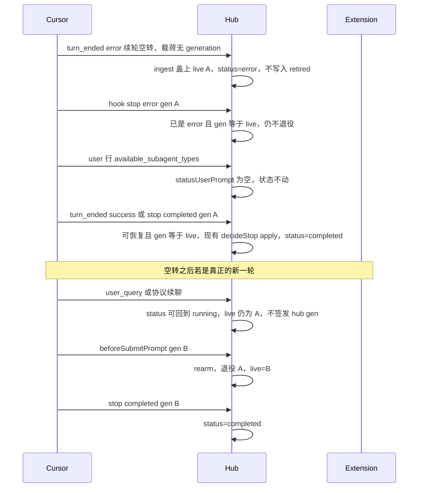

# Armada：续轮空转不得把已完成的卡留在运行中

- 日期：2026-10-13
- 状态：v1 实施基准。2026-10-13 已对照 `onStopEvent`、`reopenAfterResumeStall`、`followup`、`sweepTimeouts`、`decideStop`、`ingest` 的 `turn_ended` 合成、`transcriptUserPrompt`、`CURSOR_INTERNAL_CONTEXT_MARKERS`、`.cursor/rules/armada-durable-boundaries.mdc`，以及本机 hub 库里这张卡的事件和审计。
- 父文档：[2026-09-18-cursor-sessionend-idle-design.md](2026-09-18-cursor-sessionend-idle-design.md)；边界 [armada-durable-boundaries](../../../.cursor/rules/armada-durable-boundaries.mdc)
- 触发：真机 `r-6aa7207c-8579-4137-a6b5-e479440194c5`（Win Desktop · `c:\Users\PC\Desktop\work`）。安装包 11:46 已完成，看板仍在「运行中」转圈。

---

## 0. TL;DR

| 项 | 内容 |
| --- | --- |
| 问题 | 续轮空转的 jsonl `turn_ended` error 把 generation 退役并写成 `error` 之后，一条 Cursor 内部用户句把卡拉回 `running`，且没有新的 `live_generation_id`。同一 generation 的成功 stop 被 `STOP_GEN_RETIRED` 丢掉。 |
| 核心方案 | 空转不是这一轮的结局：不退役 live generation。同一 generation 的 `stop completed` 或 jsonl `turn_ended success` 仍走现有 `onStopEvent`。内部用户句不改状态。`running` 且 live 为空、本轮 jsonl 已成功结束的卡，由现有 15 秒清扫收口。 |
| 关键约束 | 不改 `decideStop` 的出口码。不放宽 `STOP_GEN_RETIRED`。不新增表字段。Mac 上不得在新的 owner BSP 之前退役仍活着的 generation。 |
| 明确不做 | 按墙钟把运行中的卡收成完成；已退役 generation 的 `completed` 一律放行；给这一张卡写死 id；升扩展版本。 |

## 1. 真机形状

任务 `r-6aa7207c-8579-4137-a6b5-e479440194c5`，对话 `8fe35824-e26e-41c4-953e-3d6119d259bc`。`started_at` 为 2026-10-13 10:44:51。助手在 11:46 写完：安装包 `findesk\out\CfcAIDesk-cfc-advisory-cn-2.1.53-win-x64.exe`，451 MB，退出码 0。

| seq | 时间 | 事件 | 之后的库状态 |
| --- | --- | --- | --- |
| 164 | 10:44:51 | hub `beforeSubmitPrompt` | 续聊「打完包了再通知我」。审计 `GEN_ARMED`，`3b920548-784b-4d5c-9b54-2d7ee2676bbe`，`source=hub_windows` |
| 171 | 11:02:35 | transcript `turn_ended`，`status=error`，`error` 为 `RESUME_STALL_ERROR`，载荷没有 generation | `post_terminal=0`。`ingest` 把当时的 live 盖进合成 stop。`onStopEvent` 写成 `error` 并 `persistGeneration(null)`。该 id 进入 `retired_generation_ids`，`live_generation_id` 清空。审计只有 `run.error`，没有 `STOP_*` |
| 172 | 11:02:35 | hook `stop`，`status=error`，同一 generation | `post_terminal=1`。卡已经是 `error`，`onStopEvent` 在入口返回，不再退役 |
| 191 | 11:46:27 | transcript `role=user`，正文以 `<available_subagent_types>` 开头，没有 `<user_query>` | `post_terminal` 回到 0。`reopenAfterResumeStall` 把状态改回 `running`。审计 `run.running` |
| 199 | 11:46:27 | jsonl `{"type":"turn_ended","status":"success"}`，没有 generation | live 已空，且本卡有过 hub `beforeSubmitPrompt` → `STOP_NO_GEN` |
| 200 | 11:46:27 | hook `stop status=completed`，同一 `3b920548-…` | 该 id 已退役 → `STOP_GEN_RETIRED` |

收口之后的行：`status=running`，`ended_at=null`，`live_generation_id=null`，`outbound=[]`。看板转圈只看列是不是 `running`（`hub/web/src/components/Board.tsx` 的 `CardSpinner`）。

## 2. 诉求 → 设计

| 诉求 | 落点 |
| --- | --- |
| 做完的卡离开「运行中」 | 同一 generation 的成功 stop / `turn_ended success` 在空转之后仍然生效 |
| 空转不再吃掉后续收口 | 合成 stop 或 hook stop 的载荷带 `RESUME_STALL_ERROR` 时，`onStopEvent` `setStatus(error)`，不调用 `persistGeneration(null, …)`。这张卡上先执行的是 seq 171 |
| 内部用户句不再把卡拉回转圈 | `reopenAfterResumeStall` 只用 `statusUserPrompt`。`<available_subagent_types>` / `<available_subagent_models>` 返回空 |
| 已经卡住的这张卡自己好 | `sweepTimeouts` 用同一条「running、live 为空、本轮 jsonl 已成功结束」规则收口 |
| 旧 generation 不能误关新一轮 | 新 generation 武装之后，旧 id 仍进 `retired_generation_ids`。`decideStop` 不改 |

## 3. 现状

可复用：

- `decideStop`（`hub/src/generationOwnership.ts`）已区分活 generation、已退役、未武装。
- `isFalseBindTimeout` / `isFalseDispatchTimeout`（`hub/src/runs.ts`）已经允许终态之后的真实 stop 再进 `onStopEvent`。空转补收口走同一道门，不新增出口码。
- Windows followup 已用 `attachHubGeneration`，扩展已处理 `run.generation`（`extension/src/extension.ts`）。
- 详情页已有内部目录和协议句标记（`hub/web/src/chatView.ts` 的 `CURSOR_INTERNAL_CONTEXT_MARKERS`、`CURSOR_PROTOCOL_USER_PREFIXES`）。状态机还没用。
- 清扫间隔已是 15 秒（`hub/src/index.ts`）。

缺的：

- hub 与详情页共用的「这段用户正文能不能改状态」。
- 空转可恢复：`status=error` 且 `end_reason` 为 `RESUME_STALL_ERROR`，并且 stop 的 generation 与 `live_generation_id` 都非空且相等。空转那一次本身是在 `running` 上进 `onStopEvent`（seq 171），不靠这道门。
- 清扫：`running` 且 `live_generation_id` 为空，owner jsonl 最后一条 `turn_ended` 为 success，其后没有新的操作员 `<user_query>`，且没有未消费 outbound。

## 4. 原则

1. 一个 generation 只有一个结局。`RESUME_STALL_ERROR` 是提示，不是结局。
2. 忙和闲仍只看 `generation_id`。不把 prompt 正文、详情里有没有字，当成完成条件。
3. 谁算操作员输入，详情页和状态机用同一个函数。
4. 新 generation 武装之后，旧 generation 的 stop 继续忽略。
5. 不增加表字段，不增加 `decideStop` 出口码。
6. Mac：live 非空时，新一轮等到 owner BSP 再 `rearm`。不得在用户句到达时立刻退役。这条来自 `armada-durable-boundaries`，优先级高于本文件初稿里「用户句一到就 `attachHubGeneration`」的写法。

## 5. 数据

不改 `runs` 表。

| 字段 | 空转未被新轮取代 | 新轮已由 BSP / hub gen 武装 | 同一轮已成功 |
| --- | --- | --- | --- |
| `status` | `error` | `running` | `completed` |
| `end_reason` | `Agent turn stopped after repeated resume attempts made no progress` | `null` | `completed` |
| `live_generation_id` | 仍是被误报的那个 id | 新 id | `null` |
| `retired_generation_ids` | 不含这个 id | 含这个 id | 含这个 id |

`hub/src/outboundClaim.ts` 增加：

```ts
export function statusUserPrompt(payload: unknown): string | null
```

- 先走现有 `transcriptUserPrompt`。
- 原文含 `<available_subagent_types>` 或 `<available_subagent_models>` 时返回 `null`。尖括号必须在，避免操作员只是提到这两个词。
- 协议续聊（`Briefly inform the user about the task result` 等，包在 `<user_query>` 里）仍返回正文。那是新的一轮。
- `hub/web/src/chatView.ts` 改为从这里引用标记，不再各写一份。

`onStopEvent` 的可恢复条件增加第三条，与现有两条并列：`status=error` 且 `isResumeStallError(end_reason)`，并且 `genOf(stop.generation_id)` 与 `genOf(live_generation_id)` 都非空且相等。对上才进入现有 `decideStop`。对不上直接返回，不写 `STOP_GEN_MISMATCH`。两边都空不算对上，避免掉进 `STOP_NO_GEN_INITIAL`。

`claimOutbound` 仍用 `transcriptUserPrompt`。内部目录对不上已有 outbound 文案，不改 run 状态。

没有新 API，没有新错误码。

## 6. 运行时



| | macOS | Windows |
| --- | --- | --- |
| 武装 | owner BSP `rearm` / `arm` | 不装 hooks。`followup()` / dispatch 总是 `attachHubGeneration`（`hub_windows`），live 非空也替换 |
| 这张卡的 gen | — | `3b920548-…` 在 10:44:51 由 Windows followup 签发 |
| 空转 | 同一条 `onStopEvent`：载荷 `error` 为 `RESUME_STALL_ERROR` 时不退役 | 同一条。这张卡先到的是无 generation 的 `turn_ended` error，`ingest` 盖上当时的 live |
| 空转后的用户句 | 不调用 `attachHubGeneration`。`followup()` 仅在 live 已空时签发 `hub_unarmed` | 不在用户句上新签发。新 gen 仍只在中台 `followup()` |
| 已卡住且 live 已空 | 清扫直接 `completed` | 同一条清扫 |

Mac 的 `followup()` 只有 live 已空才签发 hub gen。Windows 的 `followup()` 每次都签发并替换。两条都是现有 `followup()`（`runs.ts` 里 `isWindowsMachineOs(os) || !genOf(live)`），不是空转用户句上的新路径。

live 仍是 A 时，本轮 `turn_ended success`（`ingest` 盖上 live）或 hook `stop completed` 直接收口。Windows composer 经常没有 `beforeSubmitPrompt`，不靠 BSP 收这一轮。

失败与降级：

- 扩展没收到 generation：不在空转用户句上新签发。卡停在 `error` 并保留 live，直到同一 generation 的成功信号或下一次 BSP。
- 只有 jsonl `turn_ended success`、hook stop 丢失：`ingest.ts` 现有映射带上 `generation_id = live`（live 非空时），走同一条可恢复路径。
- 清扫只处理 `live_generation_id` 为空的 `running`。最后一条 owner `transcript` 的 `turn_ended.status` 必须是 `success`。有 `queued` / `steered` / `injecting` 的 outbound 时跳过（`unconsumedOutboundCount`，不是只含后两态的 `hasOutstandingOutbound`）。该 `turn_ended` 之后还有 `<user_query>` 时跳过。
- 清扫不调用 `onStopEvent`。这张卡有 hub `beforeSubmitPrompt` 且 live 已空，`decideStop` 会给出 `STOP_NO_GEN`（11:46:27 的审计就是这个）。条件满足时直接 `setStatus(completed)`，`audit("hub", "STOP_ORPHAN_RUNNING", runId)`，再 `promoteNextQueued`。
- 回滚只换回 hub。字段都是旧的。已经收成 `completed` 的卡保持完成。

看板仍靠现有 `run.status`。不另加定时器。

## 7. 决策

| 决策 | 备选 | 不选的原因 |
| --- | --- | --- |
| 空转不退役 live generation | 照旧退役，成功 stop 时按「退役原因是空转」撤销 | `retired_generation_ids` 没有原因。撤销会让新一轮被旧 stop 收掉 |
| 内部用户句不改状态 | 任何 `role=user` 都复活，并补一个 hub generation | 子代理目录不是新一轮。补发 generation 会把仍在跑的 A 退役，成功 stop 又变成 `STOP_GEN_RETIRED` |
| 真正的新一轮沿用 Mac「等 BSP rearm」 | 用户句一到就 `attachHubGeneration` 并退役 A | 这违反 `armada-durable-boundaries`。`followup()` 已遵守：Mac 仅 live 已空才签发。协议 `<user_query>` 仍可把 `error` 拉回 `running`（现有 ingest 测试），但不签发、不退役。初稿若把「拉回 running」也删掉，会改坏这条测试 |
| 可恢复走现有 `onStopEvent` 入口 | 给 `decideStop` 加 `STOP_STALL_RECOVER` | 边界禁止再加出口码，除非同时改决策表、规格和真形状测试。这里不需要新码 |
| 已卡住的卡走清扫 | 手工改 `r-6aa7207c-…` | 同一形状还会出现。清扫看 running、live 空、本轮 `turn_ended success`。live 已空时不能走 `decideStop`，否则 `STOP_NO_GEN` |
| 不改 `STOP_GEN_RETIRED` | 已退役 generation 的 `completed` 一律放行 | `hub/test/ingest.test.ts` 里 r-4510dd36、r-47657619 就是放行之后新一轮被旧 stop 收掉 |

## 8. 安全

| 威胁 | 缓解 | 边界外 |
| --- | --- | --- |
| 旧 generation 的 stop 把新一轮收成完成 | 只有 BSP / 现有 hub followup 武装新 id 时才把旧 id 写入 retired。`decideStop` 不改 | 被控机伪造 `generation_id`。这是现有信任边界 |
| 内部目录被当成续聊 | `statusUserPrompt` 为空则不改状态。非空才允许 `reopenAfterResumeStall` | 新的 Cursor 注入标签不在这两个 marker 里。新标签只加进同一数组，并加一条 `outboundClaim` 测试 |
| 清扫把还在等生成的卡收掉 | 仅 live 为空，且最后一条 `turn_ended` 之后没有 `<user_query>`，且没有未消费 outbound | 转录尾部损坏、没有 `turn_ended`。清扫不动 |
| 审计对不上 | 可恢复收口沿用现有 stop 审计。清扫记 `audit("hub", "STOP_ORPHAN_RUNNING", runId)` | 无新认证面 |

## 9. 路线

v1（核验通过后只发 hub）：

| 步骤 | 验收 |
| --- | --- |
| `statusUserPrompt`；`reopenAfterResumeStall` 与会改状态的用户句改用它 | `<available_subagent_types>` 返回 `null`。`<user_query>打完包了再通知我</user_query>` 返回该句。没有尖括号、只是讨论这个词时仍返回正文 |
| 空转 stop：`setStatus(error)`，不 `persistGeneration(null)` | `live_generation_id` 仍是该 generation，retired 不含它 |
| 可恢复入口：error + 该 `end_reason` + generation 相等 | 先空转，再同一 id 的 `turn_ended success` 或 `stop completed`，状态为 `completed`。别的 generation 仍被现有 `decideStop` 忽略 |
| 真实 `<user_query>` / 协议续聊 | `statusUserPrompt` 非空时仍把 `error` 拉回 `running`，live 仍是该 generation，不调用 `attachHubGeneration`。Mac 新 generation 等 owner BSP `rearm`。Windows 新 generation 仍只在中台 `followup()` 签发 |
| `sweepTimeouts` 孤儿 `running` | 已是 `running`、live 空、owner jsonl 最后一条 `turn_ended` 为 success、其后没有 `<user_query>`、没有未消费 outbound 时收成 `completed`。不经过 `decideStop`。现有 `STOP_GEN_RETIRED` 测试仍为 `running` |
| 发布 | 只重启 hub。15 秒内 `r-6aa7207c-…` 进入「已完成」。扩展版本不变 |

v1.5 的触发条件：v1 上线后 7 天内再出现 `running` 且 `live_generation_id` 为空超过 2 分钟。那时再给 `setStatus(running)` 加「live 必须非空」的审计。v1 不做这道闸，避免卷进尚未武装的 `dispatched`。

## 10. 风险

| 风险 | 影响 | 应对 | 状态 |
| --- | --- | --- | --- |
| 空转后先到的是另一个 generation 的 stop，live 仍是 A | 可恢复条件对不上，入口返回，卡停在 `error`，live 仍是 A | 不进 `decideStop`，因此没有 `STOP_GEN_MISMATCH` 审计。等 A 的成功信号或下一次 BSP。v1 不放宽 mismatch，也不把空对空放进可恢复 | 接受 |
| 初稿「用户句立刻签发 hub gen」和 Mac 边界冲突 | 落地后协议续轮再次 `STOP_GEN_RETIRED` | 已对照 `followup()`：Mac live 非空不签发；Windows followup 仍签发并替换。用户句路径不新增签发。协议句仍可拉回 `running` | 已核对，不落地 |
| 清扫和正在写的 jsonl 竞态 | 尾部暂时还是上一次 `turn_ended` | 其后有 `<user_query>` 则不收口 | v1 必须做 |
| 新 hub 起来前这张卡仍转圈 | 操作员继续看到运行中 | 发布本身收口。发布前不要手工改库 | 等发布 |

无跨仓顺序。`findesk` 安装包不用重打。hub 先于扩展；旧扩展保持兼容。

## 11. 评审

- [x] Mac 已对照 `onStopEvent`、`reopenAfterResumeStall`、`decideStop`、`followup()` 和 durable boundaries 改过本文件
- [x] v1 / v1.5 的范围和触发条件还在
- [x] 不做项、清扫的跳过条件、回滚还在
- [x] 没有新的 `decideStop` 出口码
- [x] 修订记录写了核验改了哪几句

## 12. 修订

| 日期 | 变更 |
| --- | --- |
| 2026-10-13 | 初稿。依据 `r-6aa7207c-…` 事件 172、191、199、200。写明初稿里「用户句立刻 `attachHubGeneration`」与 Mac 边界冲突，核验前不得落地。 |
| 2026-10-13 | 核验。退役发生在 seq 171 的 `turn_ended` error（ingest 盖 live），不是 seq 172；172 的 `post_terminal=1`，`onStopEvent` 已返回。`followup()` 不是「仅 live 已空才签发」：Windows 总是替换。可恢复要求两边 generation 都非空；对不上直接返回，不写 `STOP_GEN_MISMATCH`。`statusUserPrompt` 为空则不改状态。协议 `<user_query>` 仍可拉回 `running`，但不签发 hub gen。清扫不走 `onStopEvent`（否则 `STOP_NO_GEN`），未消费 outbound 含 `injecting`。 |
